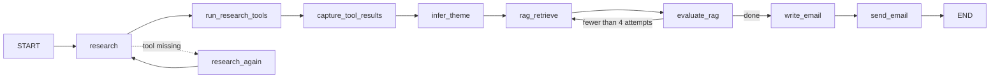

# Morning Email Agent

A LangGraph agent that sends you a personalized HTML email every morning: local weather, an Indian history fact for today's date, one important India news item from yesterday, and a real line from your own notes.

The LLM decides what to fetch and writes a few short text fields. **Python controls the facts and the layout**, so the email looks the same every day and can't be broken by a bad model reply.

## What the email contains

| Section | Source |
|---|---|
| Greeting and theme | LLM, as JSON text fields |
| A note from your own journey | Exact quote from your FAISS notes index, verified by Python |
| Today's weather | Open-Meteo, formatted by Python |
| On this day in Indian history | Tavily search, summarized by the LLM |
| Yesterday's India news | Tavily search, summarized by the LLM |
| Closing line | LLM |

If no real quote is found in your notes, a generic encouraging thought is used instead. Nothing about you is ever invented.

## How it works



1. **Research:** the LLM calls three tools: weather, history for today's date, and news from yesterday.
2. **Theme:** the LLM finds a natural theme connecting them and writes a first search query for your notes.
3. **RAG loop (4 attempts):** each attempt searches your FAISS index with a new angle. The LLM picks one exact quote, and Python rejects it unless it is a literal substring of the retrieved text. The highest-scoring verified quote wins.
4. **Write:** the LLM returns compact JSON with `greeting`, `theme`, `history`, `news` and `closing`. Python escapes the text and renders it into fixed HTML cards.
5. **Send:** the email goes out through Gmail SMTP, or is only printed in dry-run mode.

## Requirements

- Python 3.10 or newer
- API keys for [Groq](https://console.groq.com), [Tavily](https://tavily.com) and [Google AI Studio](https://aistudio.google.com) (for embeddings)
- A Gmail account with an [app password](https://support.google.com/accounts/answer/185833) (needs 2-step verification)
- A FAISS index of your personal notes in `faiss_index/`

## Installation

```bash
git clone <your-repo-url>
cd <your-repo>
python -m venv .venv
source .venv/bin/activate        # Windows: .venv\Scripts\activate
pip install langchain langgraph langchain-groq langchain-tavily \
            langchain-community langchain-google-genai faiss-cpu python-dotenv
```

## Configuration

Create a `.env` file (never commit it):

```env
# Required
TAVILY_API_KEY=your_tavily_key
GROQ_API_KEY=your_groq_key
GOOGLE_API_KEY=your_google_key

# Required only when actually sending
gmail=your_address@gmail.com
google_app_pass=your_16_char_app_password

# Optional
RECIPIENT_EMAIL=you@example.com
SENDER_NAME=my-ai-agent
DRY_RUN=true
CITY=Lucknow
REGION=Uttar Pradesh
COUNTRY=India
LAT=26.8467
LON=80.9462
```

| Variable | Default | Purpose |
|---|---|---|
| `DRY_RUN` | `true` | Print the HTML instead of sending. Set `false` to send. |
| `RECIPIENT_EMAIL` | set in code | Where the email goes. |
| `CITY`, `REGION`, `COUNTRY`, `LAT`, `LON` | Lucknow | Location used for weather. A CI runner's IP location is meaningless, so set these explicitly. |
| `gmail`, `google_app_pass` | none | Gmail login for sending. |

## Building your notes index

The "note from your own journey" comes from a FAISS index saved in `faiss_index/`. Build it once from your own text files with the same embedding model the agent uses:

```python
from langchain_community.vectorstores import FAISS
from langchain_google_genai import GoogleGenerativeAIEmbeddings
from langchain_text_splitters import RecursiveCharacterTextSplitter

text = open("my_notes.txt", encoding="utf-8").read()
chunks = RecursiveCharacterTextSplitter(chunk_size=800, chunk_overlap=100).split_text(text)
embeddings = GoogleGenerativeAIEmbeddings(model="models/gemini-embedding-001")
FAISS.from_texts(chunks, embeddings).save_local("faiss_index")
```

> Retrieved passages are sent to the LLM provider so it can pick a quote. Keep anything you consider sensitive out of the index.

## Usage

```bash
# Safe test: prints the email HTML, sends nothing
python morning_agent.py

# Real send
DRY_RUN=false python morning_agent.py
```

On success the script prints the send result, the verified quote (or a note that none was found), and the final HTML.

## Run it daily with GitHub Actions

Add your keys under **Settings > Secrets and variables > Actions**, then create `.github/workflows/morning.yml`:

```yaml
name: Morning email
on:
  schedule:
    - cron: "30 0 * * *"      # 06:00 IST (GitHub uses UTC)
  workflow_dispatch:
jobs:
  send:
    runs-on: ubuntu-latest
    steps:
      - uses: actions/checkout@v4
      - uses: actions/setup-python@v5
        with:
          python-version: "3.11"
      - run: pip install langchain langgraph langchain-groq langchain-tavily langchain-community langchain-google-genai faiss-cpu python-dotenv
      - run: python morning_agent.py
        env:
          TAVILY_API_KEY: ${{ secrets.TAVILY_API_KEY }}
          GROQ_API_KEY: ${{ secrets.GROQ_API_KEY }}
          GOOGLE_API_KEY: ${{ secrets.GOOGLE_API_KEY }}
          gmail: ${{ secrets.GMAIL }}
          google_app_pass: ${{ secrets.GOOGLE_APP_PASS }}
          RECIPIENT_EMAIL: ${{ secrets.RECIPIENT_EMAIL }}
          DRY_RUN: "false"
```

Scheduled runs can start several minutes late, which is normal on GitHub's free runners. The `faiss_index/` folder must be committed or otherwise available to the job.

## Project structure

```
.
├── morning_agent.py     # the whole agent: tools, graph, email rendering, sending
├── faiss_index/         # your notes index (index.faiss, index.pkl)
├── .env                 # local secrets (git-ignored)
└── README.md
```

## Customizing

- **Look of the email:** edit the colors and the `_card`, `render_weather_card` and `render_email_html` functions.
- **Tone and length:** change the word limits in the system prompt inside `write_email_node`.
- **More sections:** add a field to the JSON prompt, to the `fields` dict, and a new `_card(...)` in `render_email_html`.
- **RAG effort:** change `MAX_RAG_ATTEMPTS`.
- **Model:** change `model=` in `init_chat_model`. Pick a model that supports tool calling.

## Troubleshooting

| Problem | Likely cause and fix |
|---|---|
| `Missing required environment variable` | A key is missing from `.env` or the Actions secrets. |
| Model not found (404) | The model ID is wrong. Check Groq's current model list. |
| Empty or cut-off JSON | `max_tokens=900` includes hidden reasoning. Raise it or use a non-reasoning model. |
| Email is generic and has no quote | No exact quote was found. Check the printed RAG output and that the index has relevant content. |
| `Email send failed: SMTPAuthenticationError` | Use a Gmail app password, not your normal password. |
| FAISS load error | `faiss_index/` is missing, or was built with a different embedding model. |

## Security notes

- Keep `.env` out of git and use repository secrets in CI.
- `allow_dangerous_deserialization=True` is required to load FAISS indexes, so only load an index you created yourself.
- All LLM text is HTML-escaped before it goes into the email.
- Tool results are treated as data, not instructions, to reduce prompt-injection risk from web content.
